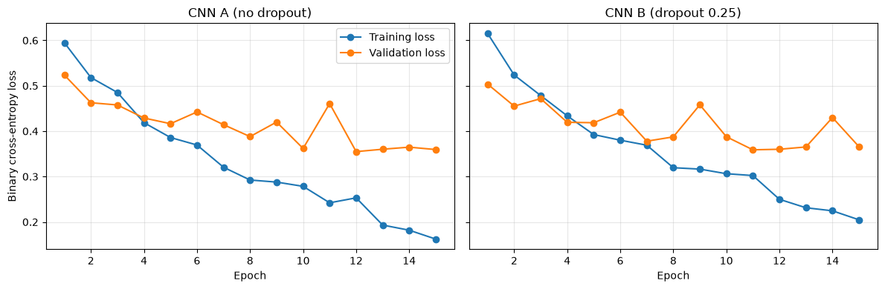
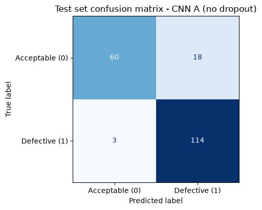

## Problem and data

We classify photographs of cast parts as **defective (1)** or **acceptable (0)**. We use the
original *casting_512x512* collection [1]: 1,300 top-view photographs (512 × 512 RGB) of
cast submersible pump impellers, 781 defective and 519 acceptable. The audit
found no unreadable files and no exact duplicates (by hashing decoded pixels), so nothing
was excluded. A stratified 70/15/15 split with seed 770 gives 910 training, 195
validation, and 195 test images (117 defective, 78 acceptable in each of the last two).
All models use the same input: grayscale, resized to 64 × 64 (bilinear), scaled to
[0, 1], with no augmentation or learned normalization.

## Models

**Baseline.** scikit-learn logistic regression [2] on the 4,096 flattened pixels (lbfgs,
C = 1.0, no class weighting, tolerance 1e-6). The default tolerance (1e-4) stopped early
at a machine-dependent point, so team members' results differed by one image; with 1e-6
it converges fully (643 iterations, no warnings).

**CNN.** A small PyTorch [3] network with two convolutional blocks (3 × 3 convolution →
ReLU → 2 × 2 max-pooling, with 16 and 32 filters), followed by a 256-unit fully connected
layer with ReLU and dropout, and one output (a logit for "defective"). We trained with
binary cross-entropy on logits, Adam [4] (learning rate 0.001), batch size 32, and 15
epochs, and used the weights after the final epoch. The network has 2.1 million
parameters, almost all in the first fully connected layer (8,192 → 256). Training ran on
the CPU (Python 3.12.14, PyTorch 2.15.0, macOS); seeds were reset to 770 before each run.

**Controlled experiment.** CNN B is identical to CNN A except for the dropout probability,
which is 0.25 instead of 0.0 [5]. We expected dropout to reduce overfitting and possibly
improve validation F1, at some risk to recall. That did not happen: CNN B scored lower on
validation F1 (0.864 vs. 0.876) and recall (0.897 vs. 0.906). Its final training loss was
higher (0.205 vs. 0.162), as expected with dropout, but its validation loss was not lower
(0.366 vs. 0.360). For both runs, validation loss levels off around 0.36 after about epoch
12 while training loss keeps falling (Figure 1). With one seed and 195 validation images,
the 0.012 difference in F1 amounts to about two predictions.

## Validation comparison and selection

We selected by **validation F1 for the defective class**, with a fixed rule that
P(defective) ≥ 0.5 means defective. Ties would go to the simpler model. **CNN A was
selected.** The test set was not used until the selection was final, and the notebook
re-checks the frozen model before testing it.

| Configuration | Precision | Recall | F1 | Accuracy | Missed defects | Good parts rejected | Training time (s) |
|---|---|---|---|---|---|---|---|
| Logistic regression | 0.861 | 0.846 | 0.853 | 0.826 | 18 | 16 | 1.0 |
| **CNN A (no dropout)** | 0.848 | 0.906 | **0.876** | 0.846 | 11 | 19 | 14.4 |
| CNN B (dropout 0.25) | 0.833 | 0.897 | 0.864 | 0.831 | 12 | 21 | 12.5 |

: Validation results (n = 195). Precision, recall, and F1 are for the defective class.

{width=68%}

## Test results for the selected model (evaluated once)

| Model | Precision | Recall | F1 | Accuracy |
|---|---|---|---|---|
| CNN A (no dropout) | 0.864 | 0.974 | 0.916 | 0.892 |

: Test results (n = 195), defective class.

{width=28%}

The model caught **114 of 117** defective castings and missed 3 (false negatives). It
rejected **18 of 78** acceptable castings (false positives, 23%). Test F1 (0.916) is higher
than validation F1 (0.876). With 195 images per set this reflects sampling variation, not
an improvement, and nothing was changed after testing.

**Error analysis.** In inspection, **false negatives matter more**: a missed defect can
fail in service or lead to a recall, while a false positive costs a re-check or a
scrapped good part. The model fits that priority (recall 0.974), but flagged parts would
still need manual re-inspection. Two of the three
missed defects were close to the threshold (P = 0.38 and 0.45), and their visible defects
are small rim marks or notches that cover only a pixel or two at 64 × 64. The third (P =
0.016) shows no obvious defect at display size and has an unusual flat grey background,
which suggests the model may partly rely on background or lighting. The most confident
false positives (P = 0.77–0.90) show strong reflections and fine machining lines that may
resemble surface defects at low resolution.

## Limitations

1. **One product, one source, controlled photos.** All images show one impeller design
   with similar lighting, background, and framing. These results do not support claims
   about a new factory, product, camera, or setup without new labeled data.
2. **Small sets and a single run.** One prediction changes F1 by about 0.005, each model
   was trained once with one seed, and CNN results varied slightly between computers.
3. **Unrealistic class balance.** Defects are 60% of this dataset but usually rare in
   production, where precision would be much lower.
4. **Low resolution and exact-only duplicate checks.** Downsizing to 64 × 64 can hide small
   defects, and near-duplicate photos of one part could appear in more than one split.

## References

[1] R. Dabhi, *Casting Product Image Data for Quality Inspection*, Kaggle.
<https://www.kaggle.com/datasets/ravirajsinh45/real-life-industrial-dataset-of-casting-product>

[2] F. Pedregosa et al., "Scikit-learn: Machine Learning in Python," *JMLR* 12, 2011.

[3] A. Paszke et al., "PyTorch: An Imperative Style, High-Performance Deep Learning Library," *NeurIPS*, 2019.

[4] D. P. Kingma and J. Ba, "Adam: A Method for Stochastic Optimization," *ICLR*, 2015.

[5] N. Srivastava et al., "Dropout: A Simple Way to Prevent Neural Networks from Overfitting," *JMLR* 15, 2014.

## Team contributions

<!-- TEAM: confirm or edit each line before submitting. -->

**Supriya Gurung:** project setup, data audit, split, preprocessing, logistic regression
baseline. **Sydney Epke:** CNN design and training, dropout experiment, validation
comparison, loss curves, model selection. **Jennifer Isobe:** review against the guide,
reproducibility fixes (data path, split checks, environment record, solver tolerance),
selection checks, test evaluation and error analysis, notebook merging, discussion, report.

## AI-assistance disclosure

<!-- TEAM: add any other AI use by any member, or remove this note if none. -->

We used Claude (Anthropic) via Claude Code to review the repository against the guide,
help write the split-check, selection-check, and test-evaluation code, merge notebooks, and
draft parts of the discussion and this report. The team made the experiment decisions and
reviewed, and can explain, all submitted code and text.
